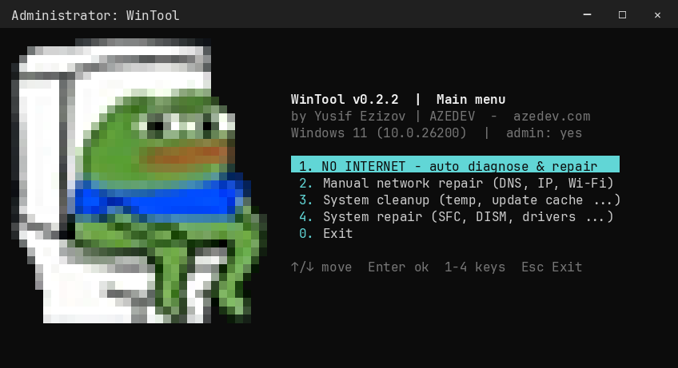

# WinTool

**[English](#english) · [Azərbaycanca](#azərbaycanca) · [Русский](#русский)**

Menu-driven repair tool for Windows 7 / 8 / 10 / 11, written in Rust. Single `.exe`, no installer, no runtime DLLs.

**by Yusif Ezizov | AZEDEV** · [azedev.com](https://azedev.com) · [guns.lol/azizowv](https://guns.lol/azizowv)



<sub>Main menu on a Windows 10/11 console (truecolor). Rendered from the program's own art and menu layout. On the Windows 7 console the banner uses 16 colors and the boxes are ASCII.</sub>

---

## English

### What it does

**1. FULL CHECK — find & fix everything (unattended, beta).** One run, no questions, 20-60 minutes.
Report: `WinTool-full-report.txt`, hardware warnings at the very top. A restore point is created first.

| Area | What it checks and fixes |
|---|---|
| Hardware | Failing disks (SMART / disk health), disk read errors, nearly full system drive, blue screens (code + likely cause), sudden shutdowns, CPU / RAM errors (WHEA), worn battery, damaged user profiles, programs that keep crashing. Hardware cannot be fixed by software: red warnings, and a suspected RAM fault offers Windows Memory Diagnostic. |
| Hidden problems | Blocked Task Manager / Registry Editor / Control Panel, hijacked programs (IFEO), changed Winlogon shell / Userinit, AppInit DLLs, hijacked `hosts` file (backed up, bad lines only commented out), dead proxies, Defender switched off by policy or blinded by exclusions, firewall / UAC off, startup entries of deleted programs. |
| Services & settings | Disabled vital Windows services, page file off, pending restarts. |
| Everything else | Internet, all devices and drivers, sound, virus scan (below), junk files, DISM + SFC. |

**2. No internet — automatic diagnose & repair.** Finds where the problem is, fixes it, and writes a report
(on screen, on the Desktop and next to the `.exe`: `WinTool-network-report.txt`).

| Step | What it checks and fixes |
|---|---|
| Drivers | Device Manager error codes (28 = no driver, 22 = disabled, 10/43 = not working). Rescans hardware, installs drivers from the `Drivers` folder, enables disabled adapters, restarts stuck ones. |
| Missing driver | If no suitable driver is available offline, it tells you **which driver is needed** (device, hardware ID, chip vendor) and **where to download it**: laptop maker → vendor site → Microsoft Update Catalog link for that exact hardware ID. |
| Link | Ethernet cable unplugged? Wi-Fi not connected? Tries your saved Wi-Fi networks. |
| IP / DNS | DHCP (169.254.x.x), gateway, proxy, Winsock / TCP-IP, DNS — step by step, re-testing after every fix. A working corporate proxy is left untouched; only a dead proxy (old VPN / malware leftover) is removed. |
| Hidden causes | Captive portal (hotel / office Wi-Fi login page) and a wrong clock (HTTPS sites fail) — the clock is corrected from the internet. |

| Other drivers | Once the internet works: **Windows Update** first, then the **Microsoft Update Catalog** (official signed packages; Windows version, architecture and hardware ID are checked before anything is installed), then **Snappy Driver Installer Origin** for devices that still have no driver. Shows the list, asks once, installs, says if a restart is needed. Only devices without a working driver are touched; optional updates for working devices are offered separately (default: no). |

**Safety.** Before the first system change in a session WinTool offers a System Restore point (default: yes), and the
network report records the previous DNS / proxy settings. Snappy Driver Installer runs in `select missing` mode only
(never replaces a working driver); it is downloaded to `%TEMP%\WinTool-SDIO` on the repaired PC and deleted after a
successful run (kept and reported if something failed). Its driver packs are downloaded via torrent, which some
corporate firewalls block — WinTool then reports it and moves on (30-minute limit).

**Interface.** Colored terminal UI with arrow-key menus (number keys work too, `Esc` = back), spinners for long tasks,
and a pixel-art banner. Unicode boxes on Windows 8+, ASCII on the Windows 7 console.

**3. No sound — automatic diagnose & repair** (report: `WinTool-sound-report.txt`).

> **Beta:** new in 0.3.0 and not yet tested on real hardware. If it misbehaves, please open an issue and attach the report.

| Step | What it checks and fixes |
|---|---|
| Devices & drivers | Sound card / HD Audio codec errors: enables disabled devices, restarts failing ones, installs drivers (`Drivers` folder → Windows Update → Microsoft Update Catalog → SDIO), otherwise tells you what to download. |
| Services | Windows Audio, Audio Endpoint Builder (and MMCSS on Windows 7): startup type and running state. |
| Playback devices | Enables disabled outputs, detects "nothing plugged into the jack", unmutes and raises a volume below 10 % to 50 %. |
| Test tone | Plays a tone and asks whether you heard it. If not: tries the other outputs (monitor / HDMI, headset), restarts the audio stack, and on Windows 10 2004+ reinstalls the sound driver. |

**4. Virus scan — WinTool scanner + Windows Defender** (report: `WinTool-virus-report.txt`). A small LOKI-style IOC scanner
written in Rust, next to Defender.

| | |
|---|---|
| Where | Running programs, services, drivers, Run / RunOnce, scheduled tasks, Startup folders, Temp / AppData / Downloads / Desktop / ProgramData / Public. |
| How | SHA-256 against ~160 000 known malware hashes, file-name IOCs, connections to botnet servers, and behaviour rules: Windows process names outside the Windows folder, double extensions (`invoice.pdf.exe`), encoded / downloading PowerShell, mshta / regsvr32 / rundll32 / certutil tricks, unsigned programs starting from Temp. |
| Action | Stops the process, disables its startup entries, moves the file to an admin-only quarantine (restorable from the menu). Signed files and files inside the Windows folder are never quarantined. Then: Defender definitions update + quick scan. |
| Offline | The databases are saved to `WinTool-db` next to the `.exe`, so the scan also works offline from a USB stick. |
| USB worms | Flash drives and external disks are cleaned too: worm shortcuts (`Folder.lnk` → `cmd /c start x.vbe`), the scripts / programs they start and `autorun.inf` go to quarantine, and the folders the worm hid become visible again. On the PC: encoded scripts (`.vbe` / `.jse`) and the startup entries that run them are removed, the running `wscript` is stopped. |

**5. App installer** — 26 popular programs (browsers, 7-Zip, VLC, PDF, LibreOffice, codecs, Telegram, WhatsApp, Zoom,
AnyDesk, TeamViewer, Steam, VC++ / .NET / DirectX runtimes …) in one go. Windows 10 / 11: `winget`; Windows 7 and PCs
without winget: official direct downloads (only programs that still support that Windows). A downloaded installer runs
only with a valid digital signature.

**6. Network repair (manual)** — full reset, DNS flush, IP renew, connection test, DNS servers, proxy reset, Wi-Fi profiles.
**7. System cleanup** — temp of every user, Windows Update and Delivery Optimization caches, error reports, thumbnail cache, recycle bins of all drives (scan first, then confirm), WinSxS.
**8. System repair** — SFC, DISM, Windows Update reset, Print Spooler reset, icon cache, chkdsk, **find missing drivers for all devices**.

### Offline drivers (`Drivers` folder)

Put drivers into a `Drivers` folder next to `WinTool.exe`: `.inf` (with their files), `.cab` from the Microsoft Update Catalog, or `.zip`.
WinTool unpacks the archives and installs everything; Windows picks the right driver for each device by hardware ID.
`.exe` installers cannot be installed automatically — run them directly or unpack them with 7-Zip into `Drivers`.

### Builds

| File | System |
|---|---|
| `wintool-win10-11-x64.exe` | Windows 10 / 11 |
| `wintool-win7-x64.exe` | Windows 7 64-bit |
| `wintool-win7-x86.exe` | Windows 7 32-bit |

All builds use MSVC with a static CRT. The Win7 builds import only `KERNEL32`, `ntdll`, `WS2_32` and `CFGMGR32` —
no UCRT / `api-ms-win-crt-*`, so they run on an un-updated Windows 7 too. All checks are language-independent.

### Building (cross-compile from Linux)

Requirements: [rustup](https://rustup.rs) (stable + nightly with `rust-src`), [cargo-xwin](https://github.com/rust-cross/cargo-xwin), `clang` + `lld`.

```bash
rustup toolchain install stable -t x86_64-pc-windows-msvc
rustup toolchain install nightly -c rust-src
cargo install cargo-xwin --locked
./build.sh        # output: dist/*.exe
```

The Win7 targets (`*-win7-windows-msvc`) are tier 3 in Rust, so they are built with nightly + `-Zbuild-std`.

---

## Azərbaycanca

### Nə edir

**1. FULL CHECK — hər şeyi tap və düzəlt (sualsız, beta).** Bir dəfə işə salınır, heç nə soruşmur, 20-60 dəqiqə.
Hesabat: `WinTool-full-report.txt`, hardware xəbərdarlıqları ən yuxarıda. Əvvəlcə bərpa nöqtəsi yaradılır.

| Sahə | Nəyi yoxlayır və düzəldir |
|---|---|
| Hardware | Xarab olmağa başlayan disklər (SMART / disk sağlamlığı), disk oxuma xətaları, dolmuş sistem diski, mavi ekranlar (kod + ehtimal olunan səbəb), gözlənilməz söndürülmələr, CPU / RAM xətaları (WHEA), köhnəlmiş batareya, xarab istifadəçi profili, tez-tez çökən proqramlar. Hardware-i proqram düzəldə bilməz: qırmızı xəbərdarlıq; RAM şübhəsində Windows Memory Diagnostic təklif olunur. |
| Gizli problemlər | Bloklanmış Task Manager / Registry Editor / Control Panel, ələ keçirilmiş proqramlar (IFEO), dəyişdirilmiş Winlogon shell / Userinit, AppInit DLL-lər, `hosts` faylı (ehtiyat nüsxə, pis sətirlər yalnız şərhə çevrilir), ölü proxy-lər, siyasətlə söndürülmüş və ya istisnalarla "kor edilmiş" Defender, söndürülmüş firewall / UAC, silinmiş proqramların startup yazıları. |
| Servislər və ayarlar | Söndürülmüş vacib Windows servisləri, söndürülmüş pagefile, gözləyən restartlar. |
| Qalan hər şey | İnternet, bütün cihazlar və driverlər, səs, virus skanı (aşağıda), lazımsız fayllar, DISM + SFC. |

**2. İnternet işləmir — avtomatik tap və həll et.** Problemin harada olduğunu özü tapır, düzəldir və hesabat yazır
(ekranda, Desktop-da və `.exe`-nin yanında: `WinTool-network-report.txt`).

| Addım | Nəyi yoxlayır və düzəldir |
|---|---|
| Driver | Device Manager xəta kodları (28 = driver yoxdur, 22 = söndürülüb, 10/43 = işləmir). Cihazları yenidən skan edir, `Drivers` qovluğundan driver quraşdırır, söndürülmüş adapteri yandırır, ilişəni yenidən başladır. |
| Çatışmayan driver | Uyğun driver offline yoxdursa, **hansı driverin lazım olduğunu** (cihaz, hardware ID, çip istehsalçısı) və **haradan endirməli olduğunu** deyir: noutbuk istehsalçısı → çip istehsalçısının saytı → həmin hardware ID üçün Microsoft Update Catalog linki. |
| Bağlantı | Ethernet kabeli qoşulubmu? Wi-Fi qoşulubmu? Saxlanmış Wi-Fi şəbəkələrinə özü qoşulur. |
| IP / DNS | DHCP (169.254.x.x), gateway, proxy, Winsock / TCP-IP, DNS — addım-addım, hər düzəlişdən sonra yenidən test. İşləyən korporativ proxy-yə toxunmur, yalnız ölü proxy-ni (köhnə VPN / virus qalığı) söndürür. |
| Gizli səbəblər | Captive portal (hotel / ofis Wi-Fi login səhifəsi) və səhv saat (HTTPS saytları açılmır) — saatı internetdən düzəldir. |

| Digər driverlər | İnternet işləyəndən sonra: əvvəlcə **Windows Update**, sonra **Microsoft Update Catalog** (rəsmi imzalı paketlər; quraşdırmadan əvvəl Windows versiyası, arxitektura və hardware ID yoxlanılır), hələ də driveri olmayan cihazlar üçün **Snappy Driver Installer Origin**. Siyahını göstərir, bir dəfə soruşur, quraşdırır, restart lazımdırsa deyir. Yalnız driveri işləməyən cihazlara toxunur; işləyən cihazlar üçün optional yeniləmələr ayrıca təklif olunur (default: yox). |

**Təhlükəsizlik.** Sessiyada ilk sistem dəyişikliyindən əvvəl System Restore point təklif edir (default: bəli), şəbəkə
hesabatına köhnə DNS / proxy ayarları yazılır. Snappy Driver Installer yalnız `select missing` rejimində işləyir (işləyən
driveri heç vaxt dəyişmir); təmir olunan kompüterdə `%TEMP%\WinTool-SDIO`-ya endirilir və uğurlu işdən sonra silinir
(alınmasa saxlanır və hesabatda göstərilir). Driver paketləri torrent ilə endirilir — bəzi korporativ firewall-lar bunu bloklayır,
o zaman WinTool bunu yazıb davam edir (30 dəqiqə limit).

**İnterfeys.** Rəngli terminal UI, ox düymələri ilə menyu (rəqəmlər də işləyir, `Esc` = geri), uzun işlərdə spinner,
piksel-art banner. Windows 8+ üçün Unicode çərçivələr, Windows 7 konsolunda ASCII.

**3. Səs yoxdur — avtomatik tap və həll et** (hesabat: `WinTool-sound-report.txt`).

> **Beta:** 0.3.0-da yenidir, hələ real kompüterlərdə test edilməyib. Problem olsa, issue açın və hesabatı əlavə edin.

| Addım | Nəyi yoxlayır və düzəldir |
|---|---|
| Cihazlar və driverlər | Səs kartı / HD Audio codec xətaları: söndürülmüş cihazı yandırır, işləməyəni yenidən başladır, driver quraşdırır (`Drivers` qovluğu → Windows Update → Microsoft Update Catalog → SDIO), olmasa nəyi endirməli olduğunu deyir. |
| Servislər | Windows Audio, Audio Endpoint Builder (Windows 7-də MMCSS də): başlanğıc növü və işləmə vəziyyəti. |
| Səs çıxışları | Söndürülmüş çıxışları yandırır, "jack-a heç nə qoşulmayıb" halını tapır, səsi açır (mute), 10 %-dən aşağı səsi 50 %-ə qaldırır. |
| Test səsi | Səs çalır və eşidib-eşitmədiyini soruşur. Eşitməsən: digər çıxışları sınayır (monitor / HDMI, qulaqlıq), audio sistemini yenidən başladır, Windows 10 2004+ üzərində səs driverini yenidən quraşdırır. |

**4. Virus skanı — WinTool skaneri + Windows Defender** (hesabat: `WinTool-virus-report.txt`). Rust-da yazılmış kiçik,
LOKI üslubunda IOC skaneri, Defender ilə birlikdə.

| | |
|---|---|
| Harada | İşləyən proqramlar, servislər, driverlər, Run / RunOnce, planlaşdırılmış tapşırıqlar, Startup qovluqları, Temp / AppData / Downloads / Desktop / ProgramData / Public. |
| Necə | ~160 000 məlum virus hash-ı ilə SHA-256 müqayisəsi, fayl adı IOC-ları, botnet serverlərinə bağlantılar və davranış qaydaları: Windows qovluğundan kənarda Windows proses adları, ikiqat uzantı (`qaime.pdf.exe`), şifrələnmiş / endirən PowerShell, mshta / regsvr32 / rundll32 / certutil fəndləri, Temp-dən başlayan imzasız proqramlar. |
| Nə edir | Prosesi dayandırır, startup yazılarını söndürür, faylı yalnız adminlərin açabildiyi karantinə köçürür (menyudan geri qaytarmaq olar). İmzalı fayllara və Windows qovluğundakı fayllara toxunmur. Sonra: Defender bazası yenilənir + sürətli skan. |
| Offline | Bazalar `.exe`-nin yanındakı `WinTool-db` qovluğuna saxlanılır — USB fləşkadan internetsiz də işləyir. |
| USB qurdları | Fləşkalar və xarici disklər də təmizlənir: virus qısayolları (`Qovluq.lnk` → `cmd /c start x.vbe`), onların işə saldığı skript / proqramlar və `autorun.inf` karantinə gedir, virusun gizlətdiyi qovluqlar yenidən görünür. Kompüterdə: şifrələnmiş skriptlər (`.vbe` / `.jse`) və onları işə salan startup yazıları silinir, işləyən `wscript` dayandırılır. |

**5. Proqram quraşdırıcı** — 26 məşhur proqram (brauzerlər, 7-Zip, VLC, PDF, LibreOffice, kodeklər, Telegram, WhatsApp, Zoom,
AnyDesk, TeamViewer, Steam, VC++ / .NET / DirectX …) bir dəfəyə. Windows 10 / 11: `winget`; Windows 7 və winget olmayan
kompüterlər: rəsmi saytdan birbaşa (yalnız həmin Windows-u dəstəkləyən proqramlar). Endirilən quraşdırıcı yalnız etibarlı
rəqəmsal imza ilə işə salınır.

**6. Şəbəkə təmiri (əl ilə)** — tam reset, DNS flush, IP yeniləmə, bağlantı testi, DNS serverləri, proxy reset, Wi-Fi profilləri.
**7. Sistem təmizliyi** — bütün istifadəçilərin temp-i, Windows Update və Delivery Optimization cache, xəta hesabatları, thumbnail cache, bütün disklərin zibil qutusu (əvvəl skan, sonra təsdiq), WinSxS.
**8. Sistem təmiri** — SFC, DISM, Windows Update reset, Print Spooler reset, ikon cache, chkdsk, **bütün cihazlar üçün çatışmayan driverləri tapmaq**.

### Offline driverlər (`Drivers` qovluğu)

`WinTool.exe`-nin yanındakı `Drivers` qovluğuna driverləri qoy: `.inf` (faylları ilə), Microsoft Update Catalog-dan `.cab`, və ya `.zip`.
WinTool arxivləri açır və hamısını quraşdırır; hər cihaz üçün düzgün driveri Windows özü hardware ID-yə görə seçir.
`.exe` installer-lər avtomatik quraşdırılmır — onları birbaşa işə sal və ya 7-Zip ilə `Drivers` qovluğuna aç.

### Build-lər

`wintool-win10-11-x64.exe` — Windows 10 / 11 · `wintool-win7-x64.exe` — Windows 7 64-bit · `wintool-win7-x86.exe` — Windows 7 32-bit.
Win7 build-ləri UCRT tələb etmir — yenilənməmiş Windows 7-də də işləyir. Bütün yoxlamalar Windows-un dilindən asılı deyil.
Build qaydası yuxarıda, English bölməsindədir.

---

## Русский

### Что умеет

**1. FULL CHECK — найти и исправить всё (без вопросов, бета).** Один запуск, ничего не спрашивает, 20-60 минут.
Отчёт: `WinTool-full-report.txt`, предупреждения об оборудовании в самом начале. Сначала создаётся точка восстановления.

| Область | Что проверяет и исправляет |
|---|---|
| Оборудование | Отказывающие диски (SMART / состояние диска), ошибки чтения, заполненный системный диск, синие экраны (код + вероятная причина), внезапные выключения, ошибки CPU / RAM (WHEA), изношенная батарея, повреждённые профили, постоянно падающие программы. Оборудование программой не починить: красные предупреждения; при подозрении на RAM предлагается Windows Memory Diagnostic. |
| Скрытые проблемы | Заблокированные диспетчер задач / редактор реестра / панель управления, перехваченные программы (IFEO), изменённые Winlogon shell / Userinit, AppInit DLL, файл `hosts` (резервная копия, плохие строки только комментируются), мёртвые прокси, Defender, отключённый политикой или «ослеплённый» исключениями, выключенные брандмауэр / UAC, автозапуск удалённых программ. |
| Службы и настройки | Отключённые важные службы Windows, отключённый файл подкачки, ожидающие перезагрузки. |
| Всё остальное | Интернет, все устройства и драйверы, звук, проверка на вирусы (ниже), мусорные файлы, DISM + SFC. |

**2. Нет интернета — автоматическая диагностика и ремонт.** Сам находит причину, исправляет её и пишет отчёт
(на экране, на рабочем столе и рядом с `.exe`: `WinTool-network-report.txt`).

| Шаг | Что проверяет и исправляет |
|---|---|
| Драйверы | Коды ошибок диспетчера устройств (28 = нет драйвера, 22 = отключено, 10/43 = не работает). Повторно сканирует оборудование, ставит драйверы из папки `Drivers`, включает отключённые адаптеры, перезапускает зависшие. |
| Нет драйвера | Если подходящего драйвера нет офлайн, сообщает, **какой драйвер нужен** (устройство, ID оборудования, производитель чипа) и **где его скачать**: сайт производителя ноутбука → сайт производителя чипа → ссылка на Microsoft Update Catalog для этого ID оборудования. |
| Подключение | Не подключён кабель Ethernet? Не подключён Wi-Fi? Пробует сохранённые сети Wi-Fi. |
| IP / DNS | DHCP (169.254.x.x), шлюз, прокси, Winsock / TCP-IP, DNS — по шагам, с повторной проверкой после каждого исправления. Рабочий корпоративный прокси не трогает, отключает только неработающий (остаток старого VPN / вируса). |
| Скрытые причины | Captive portal (страница входа в Wi-Fi отеля / офиса) и неверное время (не открываются HTTPS-сайты) — время исправляется по интернету. |

| Остальные драйверы | Когда интернет заработал: сначала **Windows Update**, затем **Microsoft Update Catalog** (официальные подписанные пакеты; перед установкой проверяются версия Windows, архитектура и ID оборудования), затем **Snappy Driver Installer Origin** для устройств, у которых всё ещё нет драйвера. Показывает список, один раз спрашивает, устанавливает, сообщает о необходимости перезагрузки. Затрагиваются только устройства без рабочего драйвера; необязательные обновления для рабочих устройств предлагаются отдельно (по умолчанию: нет). |

**Безопасность.** Перед первым изменением системы в сеансе WinTool предлагает создать точку восстановления (по умолчанию: да),
а в отчёт о сети записываются прежние настройки DNS / прокси. Snappy Driver Installer работает только в режиме `select missing`
(никогда не заменяет рабочий драйвер); он скачивается в `%TEMP%\WinTool-SDIO` на ремонтируемом ПК и удаляется после
успешной работы (при ошибке сохраняется, путь указан в отчёте). Пакеты драйверов качаются через torrent — некоторые
корпоративные файрволы это блокируют, тогда WinTool сообщает об этом и продолжает (лимит 30 минут).

**Интерфейс.** Цветной интерфейс в терминале, меню стрелками (цифры тоже работают, `Esc` = назад), индикаторы для долгих
операций, пиксель-арт баннер. Рамки Unicode в Windows 8+, ASCII в консоли Windows 7.

**3. Нет звука — автоматическая диагностика и ремонт** (отчёт: `WinTool-sound-report.txt`).

> **Бета:** новое в 0.3.0, ещё не проверено на реальном железе. Если что-то не так, откройте issue и приложите отчёт.

| Шаг | Что проверяет и исправляет |
|---|---|
| Устройства и драйверы | Ошибки звуковой карты / кодека HD Audio: включает отключённые устройства, перезапускает неработающие, ставит драйверы (папка `Drivers` → Windows Update → Microsoft Update Catalog → SDIO), иначе подсказывает, что скачать. |
| Службы | Windows Audio, Audio Endpoint Builder (и MMCSS в Windows 7): тип запуска и состояние. |
| Устройства вывода | Включает отключённые выходы, определяет «в разъём ничего не вставлено», снимает Mute и поднимает громкость ниже 10 % до 50 %. |
| Тестовый звук | Проигрывает сигнал и спрашивает, слышно ли его. Если нет: пробует другие выходы (монитор / HDMI, гарнитура), перезапускает аудиосистему, а в Windows 10 2004+ переустанавливает звуковой драйвер. |

**4. Проверка на вирусы — сканер WinTool + Windows Defender** (отчёт: `WinTool-virus-report.txt`). Небольшой IOC-сканер
в стиле LOKI, написанный на Rust, работает вместе с Defender.

| | |
|---|---|
| Где | Запущенные программы, службы, драйверы, Run / RunOnce, задания планировщика, папки автозагрузки, Temp / AppData / Downloads / Desktop / ProgramData / Public. |
| Как | SHA-256 против ~160 000 известных хешей вредоносных программ, IOC по именам файлов, подключения к серверам ботнетов и поведенческие правила: имена системных процессов вне папки Windows, двойные расширения (`schet.pdf.exe`), закодированный / скачивающий PowerShell, трюки mshta / regsvr32 / rundll32 / certutil, неподписанные программы, стартующие из Temp. |
| Действие | Останавливает процесс, отключает автозапуск, переносит файл в карантин, доступный только администраторам (можно восстановить из меню). Подписанные файлы и файлы в папке Windows в карантин не попадают. Затем: обновление баз Defender + быстрая проверка. |
| Офлайн | Базы сохраняются в `WinTool-db` рядом с `.exe` — проверка работает и без интернета с флешки. |
| USB-черви | Флешки и внешние диски тоже очищаются: ярлыки-вирусы (`Папка.lnk` → `cmd /c start x.vbe`), запускаемые ими скрипты / программы и `autorun.inf` уходят в карантин, скрытые вирусом папки снова видны. На ПК: закодированные скрипты (`.vbe` / `.jse`) и записи автозапуска, которые их запускают, удаляются, работающий `wscript` останавливается. |

**5. Установка программ** — 26 популярных программ (браузеры, 7-Zip, VLC, PDF, LibreOffice, кодеки, Telegram, WhatsApp, Zoom,
AnyDesk, TeamViewer, Steam, VC++ / .NET / DirectX …) за один раз. Windows 10 / 11: `winget`; Windows 7 и ПК без winget:
официальные прямые загрузки (только программы, которые ещё поддерживают эту Windows). Скачанный установщик запускается
только с действительной цифровой подписью.

**6. Ремонт сети (вручную)** — полный сброс, очистка DNS, обновление IP, тест подключения, DNS-серверы, сброс прокси, профили Wi-Fi.
**7. Очистка системы** — temp всех пользователей, кэш Windows Update и Delivery Optimization, отчёты об ошибках, кэш эскизов, корзины всех дисков (сначала сканирование, затем подтверждение), WinSxS.
**8. Ремонт системы** — SFC, DISM, сброс Windows Update, сброс диспетчера печати, кэш значков, chkdsk, **поиск недостающих драйверов для всех устройств**.

### Офлайн-драйверы (папка `Drivers`)

Положите драйверы в папку `Drivers` рядом с `WinTool.exe`: `.inf` (вместе с файлами), `.cab` из Microsoft Update Catalog или `.zip`.
WinTool распаковывает архивы и устанавливает всё; нужный драйвер для каждого устройства Windows выбирает сама по ID оборудования.
Установщики `.exe` автоматически не ставятся — запустите их сами или распакуйте 7-Zip в папку `Drivers`.

### Сборки

`wintool-win10-11-x64.exe` — Windows 10 / 11 · `wintool-win7-x64.exe` — Windows 7 64-бит · `wintool-win7-x86.exe` — Windows 7 32-бит.
Сборкам для Win7 не нужен UCRT — работают и на необновлённой Windows 7. Все проверки не зависят от языка Windows.
Инструкция по сборке — выше, в разделе English.

---

## Author

**Yusif Ezizov | AZEDEV**

- Website: [azedev.com](https://azedev.com)
- Links: [guns.lol/azizowv](https://guns.lol/azizowv)

## Third-party data

The virus scanner downloads these lists at run time (nothing is bundled in the `.exe`):

- [romainmarcoux/malicious-hash](https://github.com/romainmarcoux/malicious-hash) — malware SHA-256 hashes, MIT License.
- [Neo23x0/signature-base](https://github.com/Neo23x0/signature-base) (Florian Roth) — hash, file-name and C2 IOCs,
  [Detection Rule License 1.1](https://github.com/Neo23x0/signature-base/blob/master/LICENSE); matches name the source.
- [abuse.ch Feodo Tracker](https://feodotracker.abuse.ch/) — botnet C2 IP blocklist.

## License

© 2026 Yusif Ezizov | AZEDEV

[CC BY-NC-SA 4.0](LICENSE) — free to use, modify and share with attribution; **no commercial use**; derivatives must use the same license.
CC BY-NC-SA 4.0 — istifadə, dəyişdirmə və paylaşma müəllifi göstərməklə sərbəstdir; **kommersiya istifadəsi qadağandır**.
CC BY-NC-SA 4.0 — можно использовать, изменять и распространять с указанием автора; **коммерческое использование запрещено**.
